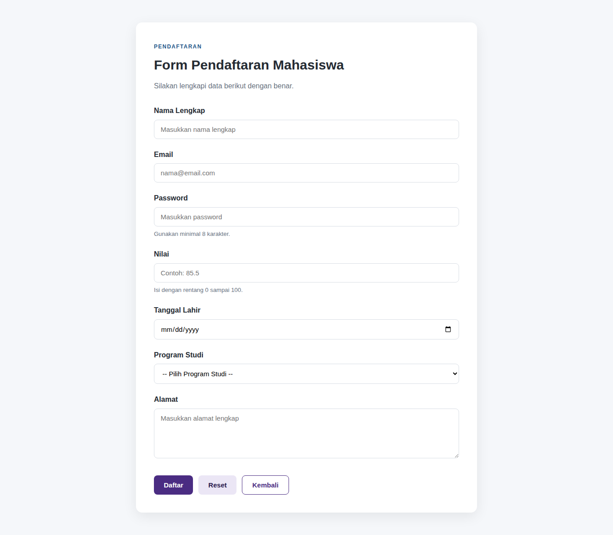
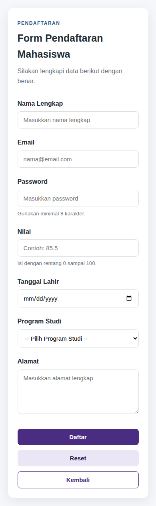
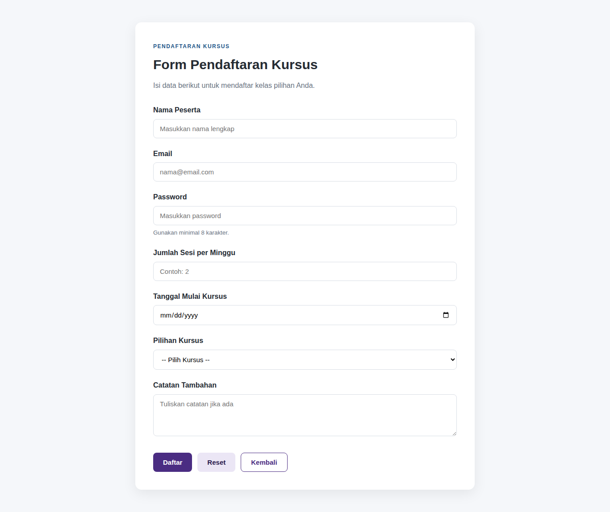
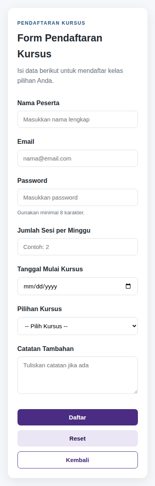

# Praktikum Desain Web - Pertemuan 6: HTML Form Dasar

Tugas praktikum Desain Web tentang HTML Form Dasar (input dan pengiriman data).

| | |
|---|---|
| Nama | Karel Abimanyu Ahpandi |
| NIM | 4525210031 |
| Kelas | A |
| Mata Kuliah | Desain Web |

## Deskripsi

Repo ini berisi dua halaman form yang memakai satu berkas CSS yang sama:

- **Studi Kasus** (`index.html`): prototipe form pendaftaran mahasiswa baru yang nantinya dapat diintegrasikan dengan backend. Data minimum: nama, email, password, nilai, dan tanggal lahir.
- **Individu** (`kursus.html`): form pendaftaran kursus dengan minimal lima tipe input dan tiga jenis button.

Setiap kontrol memiliki `label` yang terhubung lewat atribut `for` yang sama dengan `id`, serta atribut `name` sebagai key data saat form dikirim.

## Struktur Folder

```
.
├── index.html          # Studi Kasus: Form Pendaftaran Mahasiswa
├── kursus.html         # Individu: Form Pendaftaran Kursus
├── css/
│   └── style.css       # Styling bersama untuk kedua halaman
├── screenshots/        # Tampilan desktop dan mobile
└── README.md
```

## Field Form

### Studi Kasus (`index.html`)

| Label | id | name | type |
|---|---|---|---|
| Nama Lengkap | `nama` | `nama` | `text` |
| Email | `email` | `email` | `email` |
| Password | `password` | `password` | `password` |
| Nilai | `nilai` | `nilai` | `number` |
| Tanggal Lahir | `tanggal-lahir` | `tanggal_lahir` | `date` |
| Program Studi | `program-studi` | `program_studi` | `select` |
| Alamat | `alamat` | `alamat` | `textarea` |

### Individu (`kursus.html`)

| Label | id | name | type |
|---|---|---|---|
| Nama Peserta | `nama-peserta` | `nama_peserta` | `text` |
| Email | `email-peserta` | `email_peserta` | `email` |
| Password | `password-peserta` | `password_peserta` | `password` |
| Jumlah Sesi per Minggu | `sesi-per-minggu` | `sesi_per_minggu` | `number` |
| Tanggal Mulai Kursus | `tanggal-mulai` | `tanggal_mulai` | `date` |
| Pilihan Kursus | `pilihan-kursus` | `pilihan_kursus` | `select` |
| Catatan Tambahan | `catatan` | `catatan` | `textarea` |

Tiga jenis button pada kedua halaman: `submit` (Daftar), `reset` (Reset), dan button biasa `type="button"` (Kembali).

## Perubahan dari File Awal

- Menambahkan field **nilai** (`type="number"`, rentang 0 sampai 100, `step="0.01"`) sesuai data minimum studi kasus.
- Menghapus field **umur** karena dapat dihitung dari tanggal lahir dan berisiko menyimpan data yang saling bertentangan.
- Merapikan atribut `placeholder` dan `meta viewport` yang terpotong ke baris baru.
- Mengubah warna button ke palet ungu gelap bernuansa Omen (Valorant), dengan latar halaman tetap putih.

## Cara Menjalankan

1. Clone repo ini atau unduh sebagai ZIP.
2. Buka `index.html` atau `kursus.html` langsung di browser. Tidak perlu server atau instalasi apa pun.

## Catatan

- Method form adalah `post`. Atribut `action` (`/proses-pendaftaran` dan `/proses-kursus`) masih berupa alamat sementara karena praktikum ini belum memproses data di server, sehingga menekan **Daftar** akan menghasilkan error halaman tidak ditemukan.
- Tombol **Kembali** belum memiliki perilaku, karena button biasa tidak melakukan apa pun tanpa JavaScript.
- Pemilihan method `post` tidak otomatis membuat data aman. Pada penggunaan nyata tetap diperlukan HTTPS dan validasi di sisi server.

## Screenshot

### Studi Kasus

| Desktop | Mobile |
|---|---|
|  |  |

### Individu

| Desktop | Mobile |
|---|---|
|  |  |
